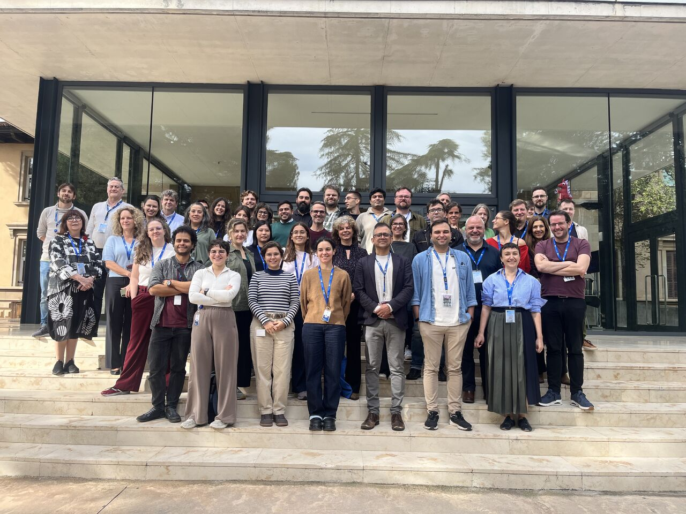
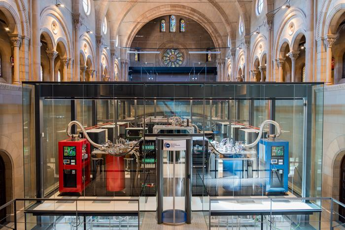
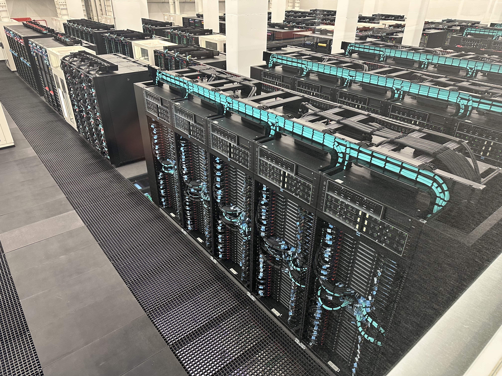

## What Is AI4SOCIAL+?
[AI Readiness for Social Impact](https://cordis.europa.eu/project/id/101292886) - or, in short, AI4SOCIAL+ is a project 
funded under the European Union’s Horizon Europe programme to support AI adoption in the humanities and social sciences.

## In-Person Kickoff in Barcelona
Following the project's [online kickoff in October](https://galaxyproject.org/news/2026-10-01-ai4social/), we gathered at the Barcelona Supercomputing Center ([BSC](https://www.bsc.es/)) to meet all project partners in person.

  
  

A highlight for us was catching a glimpse of the [MareNostrum Ona](https://www.eurohpc-ju.europa.eu/document/download/bf1e0fce-57d6-4d9a-ba29-e738a4fdd22f_en?filename=BSC_Quantum_poster_eng_por.pdf) quantum computing infrastructure, housed in a chapel. Equally exciting was seeing [MareNostrum 5](https://bsc.es/marenostrum/marenostrum-5), Spain’s most powerful classical supercomputer.

  
  

  <a href="https://www.eurekalert.org/multimedia/1133924">MareNostrum Ona</a> — Barcelona Supercomputing Center · CC BY |
  <a href="https://commons.wikimedia.org/wiki/File:BSC_MareNostrum_5_%2854686085845%29.jpg">MareNostrum 5</a> — Steve Jurvetson · <a href="https://creativecommons.org/licenses/by/4.0/">CC BY 4.0</a>
  · Both images are cropped.

## A Day Full of Insights and Fruitful Discussions

In the morning various (infrastructure) partners, including us, were introducing themselves.
Remarkable was to witnessing how quickly all embraced the rapidly evolving generative AI landscape 
(we should have counted the number of times each partner mentioned AI agents in their presentations 😁)

In the afternoon we continued with a plenary session on what **AI readiness** means to the different parties involved. 
This helped to set the tone for future discussions across the various streams and to start defining AI readiness within the project. As it turned out it is quite difficult to narrow down various aspects of AI readiness so
they stay in the scope of the project. !!! @Daniela: maybe we could add a here a word cloud of the AI readiness
brainstorming session in the google doc, if it would still be available??. !!!

Afterwards, there was a matchmaking session to identify potential collaborations between the use-cases and
the different partners. The project's five use cases cover different topics from various social sciences and humanities domains. Those range from recognising handwritten archival material to climate science and identifying citation "cartels" in academic literature. 

The day concluded with a networking dinner, where we continued our fruitful discussions. We are confident that after this full and very rich day with loads of insights, we are well set up for a successful continuation of the project. 

## Keep an Eye on AI4SOCIAL+ Updates

Stay tuned for all our latest project updates on the [Galaxy Hub](https://galaxyproject.org/hall-of-fame/ai4social/) and the [Galaxy Training Network](https://training.galaxyproject.org/training-material/hall-of-fame/ai4social/). In addition, make sure to check the [Digital Humanities and Social Sciences Special Interest Group](https://galaxyproject.org/community/sig/digital-humanities/) for new tools, workflows, training resources, and more. 
